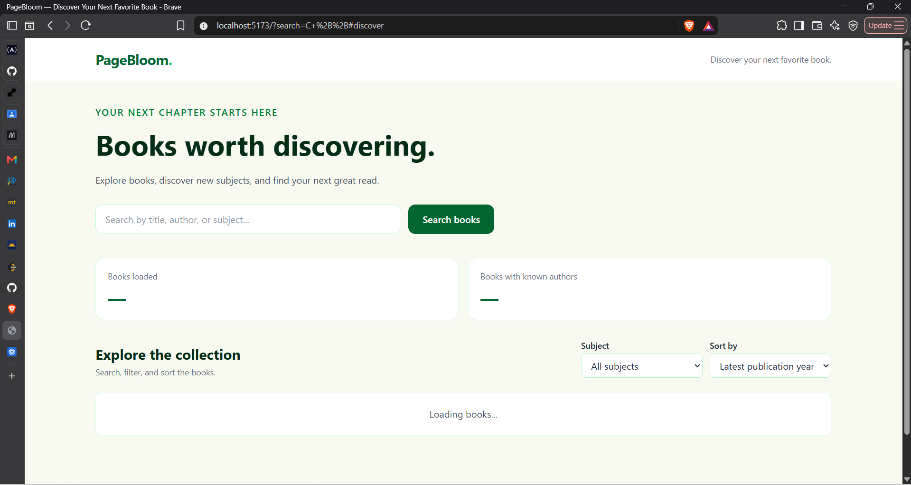
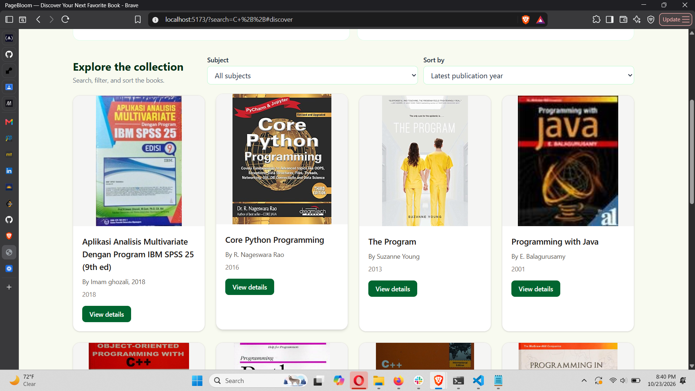
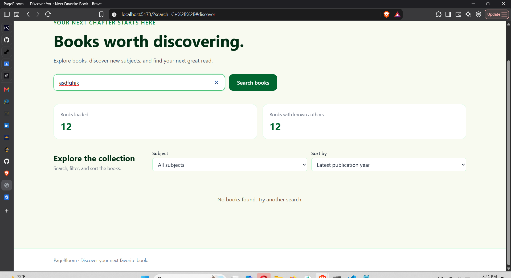
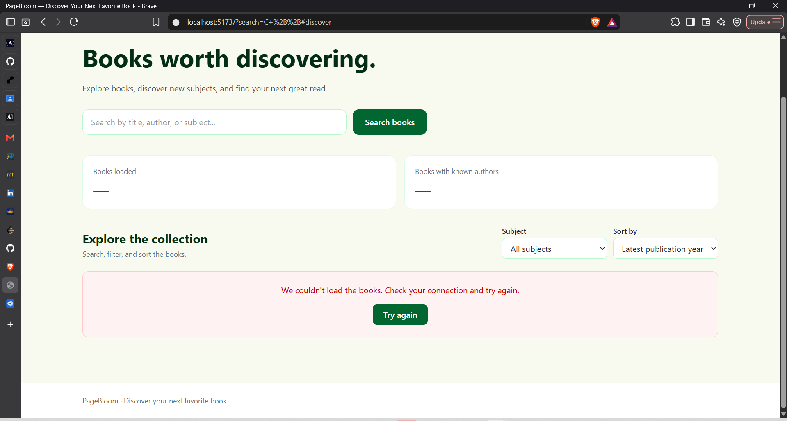

# PageBloom — Book Discovery Explorer

**Discover your next favorite book.**

PageBloom is a responsive book discovery application that allows users to explore books, search by title, author, or subject, filter by subject, sort results, and view additional book details. It retrieves book data from the Open Library Search API using asynchronous JavaScript.

## Student Information

- **Name:** Ritha IRAGENA
- **Project:** Week 5 — Async Data Explorer
- **Application:** PageBloom — Book Discovery Explorer
- **API:** Open Library Search API

## Project Links

- **GitHub Repository:** https://github.com/rithairagena13-spec/week5-async-data-explorer
- **Live Application:** [Add your deployed application URL]
- **Demo Video:** [Add your 3–5 minute demo video URL]

## Features

- Fetches book data from the Open Library Search API.
- Uses `fetch()` to make HTTP requests.
- Uses `async/await` to handle asynchronous operations.
- Uses `Promise.all()` to request multiple pages concurrently.
- Provides loading, error, retry, and empty-result states.
- Displays responsive book cards.
- Supports live, case-insensitive searching by title, author, and subject.
- Filters books by subject.
- Sorts books alphabetically by title or by publication year.
- Opens a details modal with additional book information.
- Displays statistics using `Array.prototype.reduce()`.
- Removes duplicate books using a `Map`.
- Uses a centralized state object to manage application data.
- Separates filtering and sorting logic from DOM rendering.
- Escapes dynamic text before inserting it into HTML.
- Supports closing the details modal using the close button, backdrop, or Escape key.

## Technologies Used

- HTML5
- Tailwind CSS v4
- JavaScript ES Modules
- Vite
- Open Library Search API
- JavaScript Fetch API
- Git and GitHub

## API Documentation

PageBloom uses the Open Library Search API.

Documentation: https://openlibrary.org/dev/docs/api/search

Example endpoint:

`https://openlibrary.org/search.json?q=programming&limit=6`

The application requests book information such as:

- `key` — unique identifier for a book
- `title` — book title
- `author_name` — author names
- `first_publish_year` — first publication year
- `cover_i` — cover identifier
- `subject` — book subjects
- `edition_count` — number of editions

The application requests two pages of search results concurrently. It combines the returned book arrays and uses a `Map` to remove duplicate records based on each book's `key`.

## How Asynchronous Data Fetching Works

The reusable `getJSON(url)` function sends a request using `fetch()`. It checks the HTTP response status and converts the response into JSON.

The `fetchData(query)` function creates two API URLs and uses `Promise.all()` to request both pages concurrently. After both requests complete, it combines the results, removes duplicate books, and returns an array of books.

The `loadBooks()` function uses `await` to wait for the data. While the request is running, the interface displays a loading message. If the request succeeds, the application updates its state, statistics, subject options, and book cards. If a request fails, the application displays an error message and provides a retry option.

Because `Promise.all()` rejects if either request fails, the application handles that failure through its error-handling logic.

## Application State

The application uses a centralized state object:

```javascript
const state = {
    books: [],
    searchQuery: "",
    selectedSubject: "all",
    status: "loading",
    error: null
};
```

The state stores:

- `books`: the books fetched from the API.
- `searchQuery`: the current search text.
- `selectedSubject`: the currently selected subject filter.
- `status`: the current loading or success status, or an error status.
- `error`: information about a loading failure.

## State-to-Render Flow

1. The application starts and calls `loadBooks()`.
2. The loading state is displayed.
3. `fetchData()` retrieves book data from the API.
4. The returned books are stored in `state.books`.
5. Statistics and available subject options are updated.
6. `getVisibleItems(state, sortBy)` filters and sorts the existing collection.
7. `renderBooks()` displays the visible book cards.
8. Search, subject, and sort events update the relevant state values and trigger rendering again.
9. Opening a book's details retrieves additional information for the selected book.
10. If data fetching fails, an error message and retry option are displayed.

Searching, filtering, and sorting operate on the books already loaded into the application. They do not require another collection request.

## Filtering and Sorting

The `getVisibleItems(state, sortBy)` function separates data processing from DOM rendering.

It filters the collection according to the search query and selected subject. It then sorts the filtered results by title or publication year.

The function uses `filter()` and `toSorted()` to return a new array without mutating the original `state.books` array.

## Statistics

PageBloom displays two statistics:

1. **Books loaded:** the number of books in the current collection.
2. **Books with known authors:** the number of books with author information.

Both statistics use the `reduce()` array method.

## Sample API Response and Data Transformation

A simplified example of the API response is shown below:

```json
{
  "docs": [
    {
      "key": "/works/OL12345W",
      "title": "Example Book",
      "author_name": ["Example Author"],
      "first_publish_year": 2020,
      "subject": ["Programming", "Computers"],
      "edition_count": 3
    }
  ]
}
```

This is an illustrative example, not a captured response from a specific request.

The API response contains a `docs` array. PageBloom extracts the book records from that array, combines results from the two requests, removes duplicates using each book's `key`, and returns the final collection for rendering.

## Screenshots

Add your actual application screenshots to the `screenshots/` directory.

### 1. Loading State



### 2. Success State



### 3. Empty State



### 4. Error State



## Asynchronous JavaScript Reflection

Building PageBloom helped me understand how asynchronous JavaScript allows an application to retrieve external data without blocking the entire user interface. I learned how to use `fetch()` to make HTTP requests and `async/await` to work with promises. I also learned how to check HTTP responses and handle errors when requests fail. Using `Promise.all()` helped me understand how multiple independent requests can run concurrently. I practiced transforming API responses, combining arrays, and removing duplicate records using a `Map`. I also learned how to manage application state and update the interface when users search, filter, or sort data. This project improved my understanding of separating data-processing logic from rendering and providing useful feedback during loading, empty, and error states.

## Installation and Local Setup

### Prerequisites

- Node.js installed on your computer.
- npm installed with Node.js.
- Git installed on your computer.

### 1. Clone the repository

```bash
git clone https://github.com/rithairagena13-spec/week5-async-data-explorer.git
```

### 2. Enter the project directory

```bash
cd week5-async-data-explorer
```

### 3. Install dependencies

```bash
npm install
```

### 4. Start the development server

```bash
npm run dev
```

Open the local URL displayed in your terminal.

### 5. Build for production

```bash
npm run build
```

Vite generates the production build in the `dist/` directory.

## Error Handling and Limitations

- The application depends on the availability of the Open Library API and an internet connection.
- API requests may fail because of network problems or server errors.
- `Promise.all()` rejects if either of the two requests fails.
- The number of unique books returned may be fewer than 12 if the API returns duplicate records or incomplete results.
- Some books may not have author names, publication years, descriptions, covers, or subjects.
- Book descriptions and available metadata depend on the records provided by Open Library.

## Future Improvements

- Add pagination or a load-more button.
- Add a favourites feature with local storage.
- Add a debounce to reduce processing during rapid typing.
- Improve book-detail loading and error feedback.
- Add more search and discovery options.

## Acknowledgements

- Open Library for providing public book-search data.
- The course facilitator for the Week 5 Async Data Explorer assignment.
